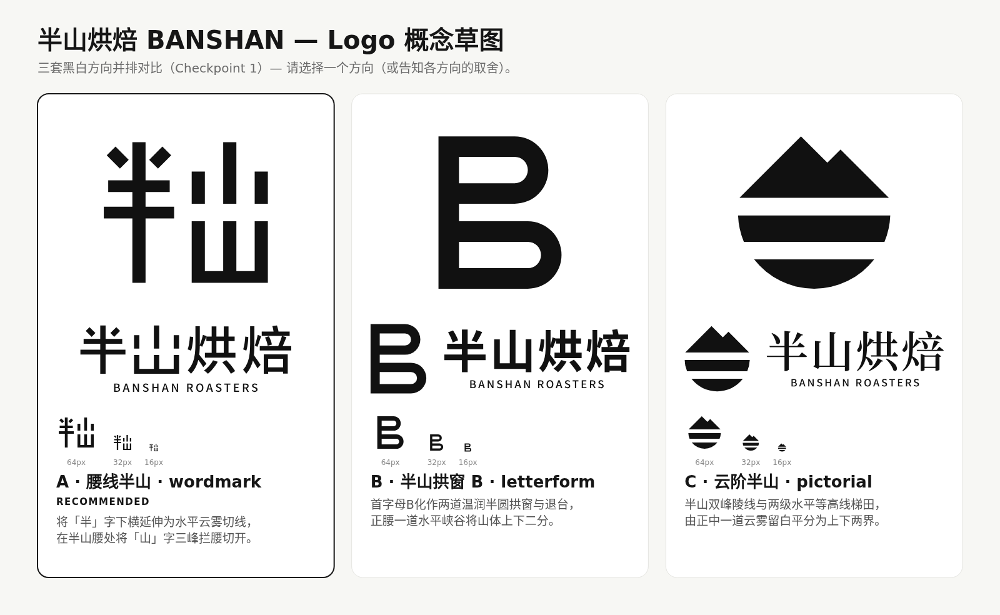

# Checkpoint 1 — 半山烘焙 (BANSHAN ROASTERS) 概念草图提案

### A — 腰线半山 (Mid-Slope Horizon) · `wordmark`（定制汉字构造字标） ← recommended
- **Idea**: 将「半」字的下横化作海拔半山腰的水平云雾线，向右自然延展为一道 24 单位高的负空间切口，将「山」字三峰在半山腰处一分为二。
- **Why it fits**:
  - **真正践行"中文为主"**：不借用西文首字母，直接把中文品牌名「半山」本身转化为可被三秒记住的视觉符号，一眼区别于 Goût & Co 等纯英文字标竞品与 AOKKA 等户外图形竞品。
  - **理念同构（"让产地自己说话"）**：水平负空间断口在视觉上制造出"山间留白与呼吸感"，呼应浅中烘克制、通透、不掩盖产区本味的态度。
  - **全尺寸与单色热敏标签实测通过**：竖笔 18/20 单位、横画 16/18 单位、云雾断口 24 单位（16 px 下仍保底 1.5 px 净空），在 16 px 浏览器 Favicon、单色牛皮纸印章及热敏批次标签上均清晰不糊。
- **Honest risk**: 纯汉字结构对非中文母语受众而言主要作为几何建筑图形被识别，需在出街包装上配合底部的 `BANSHAN ROASTERS` 副标建立双语关联。

---

### B — 半山拱窗 B (Mid-Slope Arch B) · `letterform`（几何首字母符号 + 双语组合）
- **Idea**: 将英文名首字母 `B`（Banshan）构造为上下两道温润的 28 单位等粗半圆拱窗（呼应烘焙滚筒观察窗与山地退台），正腰处由一道 24 单位水平峡谷切口将山体上下二分。
- **Why it fits**:
  - **极佳的小尺寸与数字端表现**：单字母几何结构极简（仅 19 个锚点），在 16 px 标签页图标、社交圆形头像与深浅色反转场景中表现极为稳健。
  - **温润且有秩序感**：半圆拱弧消除了工业棱角的生硬感，契合"温润手作 + 精准参数"的订阅制工作室气质。
- **Honest risk**: 以拉丁字母 `B` 作为主符号，在"中文为主"的叙事直接性上弱于方向 A，需要一定曝光周期让国内受众将 `B` 与「半山」建立联想。

---

### C — 云阶半山 (Cloud-Divided Peak & Terraces) · `pictorial`（负空间山阶图形 + 双语组合）
- **Idea**: 在圆形轮廓内，上半部为不对称 45° 双峰陵线，下半部为两级水平等高线咖啡梯田（呼应半山海拔种植带与杯测碗），由两道 24 单位水平云雾留白贯穿切分。
- **Why it fits**:
  - **零门槛的产区海拔直觉**：无需文字解释即可传达"高海拔山地风土（Terroir）"，同时以干净的几何水平切层避开了写实咖啡豆和冒气咖啡杯的品类俗套。
  - **与宋刻衬线字标形成经典冷暖对照**：几何圆章图形搭配 `Noto Serif SC` 衬线字标，适合印制在订阅制随箱风味产区卡与封口圆贴上。
- **Honest risk**: 山峰与水平条纹的组合在户外/精品茶咖品类中属于相对熟悉的母题（接近 AOKKA 等山系咖啡视觉），独特排他性不及方向 A。

---

**Independent review**: 共历经 2 轮独立评审（Round 1 检出 8 项问题：2 Blocker、5 Major、1 Minor；全部在 v3/v4 中修复完毕；Round 2 复审 0 Blocker、0 Major、2 Minor，3 套方向均获 `ship` 评级，那 2 项 Minor 细节亦已在最终版 `concepts.png` 中完成修正）。

**My recommendation**: **推荐方向 A（腰线半山）**。它是三套方案中唯一直接从汉字「半山」的字形结构长出来的原创标识——既守住了"中文为主、克制通透"的简报核心，又在 16 px 极小尺寸与单色热敏标贴上保持干净利落。

**Next**: 请挑选一个方向（或告诉我你在各套方案中分别喜欢的部分），接下来我将基于你的选择进行光学精修、定制专属色板与中英数字排版体系，并生成全套品牌资产包（Kit）。
Kit = 方形/横版/竖版/纯符号/纯字标 Logo（彩色、深色背景、纯黑、纯白、灰度，含 SVG/PNG/PDF/JPG）、实测通过的 Favicon 与 App 图标、社交头像与横幅、信头纸与页脚、名片、精品咖啡烘焙专属周边样机（豆袋、随行杯、围裙等）、Design Tokens 及品牌规范 PDF 手册。
